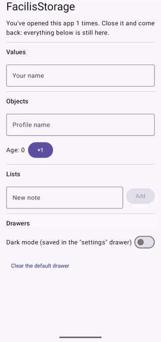

# FacilisStorage

[](https://jitpack.io/#al3j4ndrolm/FacilisStorage)
[](https://github.com/al3j4ndrolm/FacilisStorage/actions/workflows/build.yml)
[](LICENSE)

**Android local storage in one line.** No DataStore setup, no Room boilerplate, no `suspend`.

Part of the Facilis family, with [FacilisCam](https://github.com/al3j4ndrolm/FacilisCam).

<p align="center">
  
</p>

```kotlin
storage.save("name", "Ale")
val name = storage.get<String>("name")
```

Works from an Activity, Fragment, Compose or a ViewModel. No `Context`, no `init()`.

## Jetpack Compose

```kotlin
var name by rememberStorage("name", default = "")

TextField(value = name, onValueChange = { name = it })
```

Like `remember { mutableStateOf("") }`, but it's still there after the app is closed.

## Objects and lists

```kotlin
@Serializable
data class Note(val text: String, val done: Boolean = false)

storage.save("note", Note("Buy milk"))
val note = storage.get<Note>("note")

val notes = storage.list<Note>("notes")
notes.add(Note("Buy milk"))
notes.remove(Note("Buy milk"))
notes.all()                                  // List<Note>
```

In Compose: `val items by notes.collectAsState()`.

## Drawers

Keep unrelated data apart. Each drawer is its own file:

```kotlin
val settings = storage.drawer("settings")
settings.save("darkMode", true)

storage.drawer("session").clear()         // wipes only that drawer
```

## Install

Add JitPack to `settings.gradle.kts`:

```kotlin
dependencyResolutionManagement {
    repositories {
        google()
        mavenCentral()
        maven("https://jitpack.io")
    }
}
```

Then add one dependency (min SDK 23):

```kotlin
// Compose apps: rememberDrawer and list state, plus everything else
implementation("com.github.al3j4ndrolm.FacilisStorage:storage-compose:1.1.0")

// Views apps
implementation("com.github.al3j4ndrolm.FacilisStorage:storage:1.1.0")
```

To save your own classes, also apply the serialization plugin in that module:

```kotlin
plugins {
    id("org.jetbrains.kotlin.plugin.serialization") version "<your Kotlin version>"
}
```

## API

| | |
|---|---|
| `save(key, value)` | Saves text, numbers, booleans, lists, maps or `@Serializable` objects. `null` removes |
| `get<T>(key)` / `get(key, default)` | Reads a value; `null` or `default` if missing or a different type |
| `flow<T>(key)` | Emits the value now and on every change |
| `list<T>(key)` | A saved list: `add`, `remove`, `removeAt`, `removeIf`, `updateIf`, `all`, `flow` |
| `contains`, `remove`, `clear`, `keys`, `all` | Inspect and clean up |
| `drawer(name)`, `drawers()` | Named drawers |

## Good to know

- Reads are instant: each drawer is kept in memory. Saves return immediately and are written to disk in the background within milliseconds.
- Made for settings, small objects and lists of up to a few thousand items. For large or searchable datasets, use Room.
- Data is stored as plain JSON in your app's private folder. Don't store passwords or tokens.
- Changed a class? Removed fields are ignored, and new fields need a default value to read old data.

## Coming from DataDrawer?

DataDrawer was renamed to FacilisStorage in 1.1.0. Your saved data carries over, and old code still compiles with deprecation warnings that point to the new names:

| DataDrawer 1.0.0 | FacilisStorage 1.1.0 |
|---|---|
| `com.github.al3j4ndrolm.DataDrawer:datadrawer-compose` | `com.github.al3j4ndrolm.FacilisStorage:storage-compose` |
| `import io.github.al3j4ndrolm.datadrawer.*` | `import io.github.al3j4ndrolm.facilis.storage.*` |
| `datadrawer.save(...)` | `storage.save(...)` |
| `rememberDrawer(...)` | `rememberStorage(...)` |

## Contributing

```bash
./gradlew :storage:testDebugUnitTest :storage-compose:assembleRelease :sample:assembleDebug
```

`storage/` is the core library, `storage-compose/` the Compose helpers, and `sample/` a demo app.

## License

[MIT](LICENSE)
